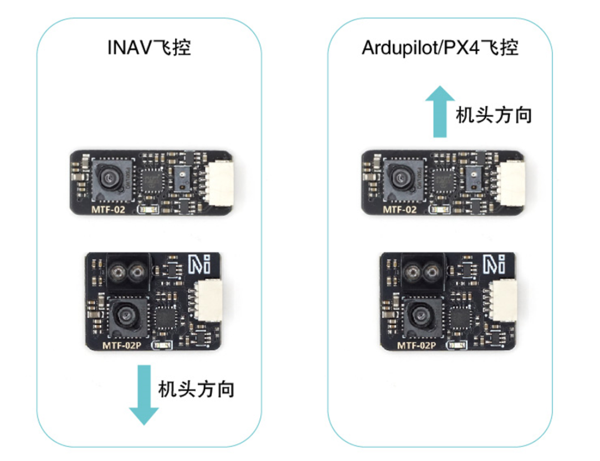

# PX4 参数百科全书

> 基准：`02_固件与配置/参数配置/Pixhawk 6C_3.0.params`
>
> 适用：Pixhawk 6C + X400 + MTF-02 室内光流方案

---

## 目录

- [一、使用约定](#一使用约定)
- [二、遥控器与通道](#二遥控器与通道)
- [三、飞行模式、解锁与安全](#三飞行模式解锁与安全)
- [四、飞行手感与位置控制（MPC）](#四飞行手感与位置控制mpc)
- [五、电池与低电量保护](#五电池与低电量保护)
- [六、电机输出与PWM](#六电机输出与pwm)
- [七、光流、测距与EKF2融合](#七光流测距与ekf2融合)
- [八、传感器安装偏移](#八传感器安装偏移)
- [九、串口与数传](#九串口与数传)
- [十、传感器与校准](#十传感器与校准)
- [十一、起飞与降落](#十一起飞与降落)
- [十二、振动抑制](#十二振动抑制)
- [十三、系统与电源管理](#十三系统与电源管理)
- [十四、日志参数](#十四日志参数)
- [十五、参数速查总表](#十五参数速查总表)

---

## 一、使用约定

- 枚举类参数必须在 QGroundControl 中确认显示名称，不要只看数字值。
- 坐标系为 **FRD（前-右-下）**：X=前, Y=右, Z=下 为正。单位**米（m）**，5 cm = `0.05`。

---

## 二、遥控器与通道

### 2.1 通道映射

| 参数 | 当前值 | 作用 |
|---|---|---|
| `RC_MAP_ROLL` | `1` | 横滚通道 |
| `RC_MAP_PITCH` | `2` | 俯仰通道 |
| `RC_MAP_THROTTLE` | `3` | 油门通道 |
| `RC_MAP_YAW` | `4` | 偏航通道 |
| `RC_MAP_ARM_SW` | `5` | 解锁开关通道 |
| `RC_MAP_KILL_SW` | `6` | 急停开关通道 |
| `RC_MAP_FLTMODE` | `7` | 飞行模式通道（三段开关） |
| `RC_MAP_OFFB_SW` | `8` | Offboard 模式开关通道 |

### 2.2 通道校准值

由 QGC 遥控校准生成，不手工改。不准则重新校准。

| 通道 | 功能 | 最小值 | 中位值 | 最大值 | 死区 |
|---|---|---|---|---|---|
| `RC1` | Roll | `1035` | `1514` | `2002` | `10` |
| `RC2` | Pitch | `1024` | `1515` | `2003` | `10` |
| `RC3` | Throttle | `1025` | `1025` | `1995` | `10` |
| `RC4` | Yaw | `1026` | `1514` | `1984` | `10` |
| `RC5` | Arm | `1024` | `1513` | `2003` | `10` |
| `RC6` | Kill | `1024` | `1513` | `2003` | `10` |
| `RC7` | Mode | `1024` | `1513` | `2003` | `10` |

---

## 三、飞行模式、解锁与安全

### 3.1 飞行模式映射

| 参数 | 当前值 | 作用 |
|---|---|---|
| `COM_FLTMODE1` | `8` | 遥控器低档对应模式 |
| `COM_FLTMODE4` | `1` | 遥控器中档对应模式 |
| `COM_FLTMODE6` | `2` | 遥控器高档对应模式 |
| `COM_FLTMODE2/3/5` | `-1` | 未启用 |

### 3.2 解锁参数

| 参数 | 当前值 | 作用 |
|---|---|---|
| `COM_ARM_WO_GPS` | `1` | 允许无 GPS 解锁；`0`=禁止, `1`=允许 |
| `COM_ARM_CHK_ESCS` | `0` | 电调反馈检查；PWM 电调无遥测时设为 `0` |
| `COM_DISARM_MAN` | `1` | 允许手动上锁 |

### 3.3 接管与失控保护

| 参数 | 当前值 | 作用 |
|---|---|---|
| `COM_RC_OVERRIDE` | `3` | 遥控覆盖自动控制模式：`0`=禁用, `1`=位置模式覆盖, `2`=位置+速度覆盖, `3`=始终启用 |
| `COM_RC_STICK_OV` | `10.0` | 摇杆接管阈值：偏离中位超过此比例即触发接管 |
| `COM_OF_LOSS_T` | `0.5` | Offboard 指令丢失超时（秒）：脚本停发 setpoint 后多久判定失联 |
| `COM_OBL_RC_ACT` | `0` | Offboard 失联后飞控执行的动作（需在 QGC 中确认枚举名） |
| `COM_RC_LOSS_T` | `0.5` | 遥控信号丢失判定时间（秒） |
| `NAV_RCL_ACT` | `1` | 遥控丢失动作（室内不能设为 RTL 返航） |
| `COM_LOW_BAT_ACT` | `2` | 低电量时飞控执行的动作 |

---

## 四、飞行手感与位置控制（MPC）

### 4.1 摇杆曲线

| 参数 | 当前值 | 作用 |
|---|---|---|
| `MPC_XY_MAN_EXPO` | `0.6` | 水平摇杆 Expo 曲线，越大中间越柔和 |
| `MPC_Z_MAN_EXPO` | `0.6` | 垂直摇杆 Expo 曲线 |
| `MPC_YAW_EXPO` | `0.6` | 偏航摇杆 Expo 曲线 |

### 4.2 速度限制

| 参数 | 当前值 | 作用 |
|---|---|---|
| `MPC_VEL_MANUAL` | `2.0` | 手动模式水平目标速度（m/s） |
| `MPC_XY_VEL_MAX` | `2.0` | 最大水平速度（m/s） |
| `MPC_Z_VEL_MAX_UP` | `2.0` | 最大上升速度（m/s） |
| `MPC_Z_VEL_MAX_DN` | `1.5` | 最大下降速度（m/s） |
| `MPC_XY_CRUISE` | `2.0` | 自动模式巡航速度（m/s） |

### 4.3 加速度限制

| 参数 | 当前值 | 作用 |
|---|---|---|
| `MPC_ACC_HOR` | `2.0` | 水平最大加速度（m/s²） |
| `MPC_ACC_UP_MAX` | `4.0` | 最大上升加速度（m/s²） |
| `MPC_ACC_DOWN_MAX` | `3.0` | 最大下降加速度（m/s²） |

### 4.4 倾角限制

| 参数 | 当前值 | 作用 |
|---|---|---|
| `MPC_TILTMAX_AIR` | `25` | 自动模式最大倾角（度） |
| `MPC_TILTMAX_LND` | `12` | 降落阶段最大倾角（度） |
| `MPC_MAN_TILT_MAX` | `25` | 手动模式最大倾角（度） |

### 4.5 悬停推力

| 参数 | 当前值 | 作用 |
|---|---|---|
| `MPC_THR_HOVER` | `0.5` | 悬停油门估计值，影响定高模式的油门中位 |
| `MPC_USE_HTE` | `1` | 启用悬停推力自学习；`0`=禁用, `1`=启用 |

### 4.6 位置与速度控制增益

| 参数 | 当前值 | 作用 |
|---|---|---|
| `MPC_XY_P` | `0.95` | 水平位置误差 → 速度指令的 P 增益 |
| `MPC_XY_VEL_P_ACC` | `1.8` | 水平速度误差 → 加速度指令的 P 增益 |
| `MPC_XY_VEL_I_ACC` | `0.4` | 水平速度误差积分的 I 增益 |
| `MPC_XY_VEL_D_ACC` | `0.2` | 水平速度误差微分的 D 增益 |
| `MPC_Z_P` | `1.0` | 垂直位置误差 → 速度指令的 P 增益 |
| `MPC_Z_VEL_P_ACC` | `4.0` | 垂直速度误差 → 加速度指令的 P 增益 |
| `MPC_Z_VEL_I_ACC` | `2.0` | 垂直速度误差积分的 I 增益 |
| `MPC_Z_VEL_D_ACC` | `0.0` | 垂直速度误差微分的 D 增益 |

---

## 五、电池与低电量保护

| 参数 | 当前值 | 作用 |
|---|---|---|
| `BAT1_N_CELLS` | `4` | 主电池串联数 |
| `BAT1_CAPACITY` | `-1` | 电池容量（mAh），`-1` 表示未设置 |
| `BAT1_V_EMPTY` | `3.6` | 单节空电电压（V） |
| `BAT1_V_CHARGED` | `4.2` | 单节满电电压（V） |
| `BAT1_V_DIV` | `18.59065` | 电压分压系数 |
| `BAT1_A_PER_V` | `36.3675` | 电流检测系数 |
| `BAT_LOW_THR` | `0.15` | 低电量触发阈值（比例，15%） |
| `BAT_CRIT_THR` | `0.07` | 严重低电量触发阈值（比例，7%） |
| `BAT_EMERGEN_THR` | `0.05` | 紧急电量触发阈值（比例，5%） |

---

## 六、电机输出与PWM

### 6.1 输出功能分配

| 参数 | 当前值 | 对应电机 |
|---|---|---|
| `PWM_MAIN_FUNC1` | `101` | M1（右前） |
| `PWM_MAIN_FUNC2` | `102` | M2（左后） |
| `PWM_MAIN_FUNC3` | `103` | M3（左前） |
| `PWM_MAIN_FUNC4` | `104` | M4（右后） |

### 6.2 PWM 范围

（以通道 1 为例，2~4 保持一致）

| 参数 | 当前值 | 作用 |
|---|---|---|
| `PWM_MAIN_DIS1` | `1000` | 未解锁时的停止信号脉宽 |
| `PWM_MAIN_MIN1` | `1100` | 解锁后最低输出脉宽 |
| `PWM_MAIN_MAX1` | `1900` | 最大输出脉宽 |

---

## 七、光流、测距与EKF2融合

### 7.1 系统能力声明

| 参数 | 当前值 | 作用 |
|---|---|---|
| `SYS_HAS_GPS` | `0` | 声明系统无 GPS，`0`=无, `1`=有 |
| `GPS_1_CONFIG` | `0` | GPS 1 接口配置，`0`=禁用 |
| `SYS_HAS_NUM_OF` | `1` | 光流传感器数量 |
| `SYS_HAS_NUM_DIST` | `1` | 测距传感器数量 |

### 7.2 EKF2 融合开关

| 参数 | 当前值 | 作用 |
|---|---|---|
| `EKF2_GPS_CTRL` | `0` | GPS 融合控制：`0`=禁用, `1`=启用 |
| `EKF2_OF_CTRL` | `1` | 光流融合控制：`0`=禁用, `1`=启用 |
| `EKF2_RNG_CTRL` | `2` | 测距融合模式：`0`=禁用, `1`=仅静止启用, `2`=始终启用 |
| `EKF2_HGT_REF` | `2` | 高度参考源：`0`=气压计, `1`=GPS, `2`=测距仪, `3`=视觉 |
| `EKF2_BARO_CTRL` | `1` | 气压计融合：`0`=禁用, `1`=启用。测距失效时的备用高度源 |
| `EKF2_MIN_RNG` | `0.02` | 最小有效测距值（m） |

### 7.3 光流参数

| 参数 | 当前值 | 作用 |
|---|---|---|
| `EKF2_OF_QMIN` | `1` | 光流最低质量门限，低于此值不融合 |
| `SENS_FLOW_ROT` | `0` | 光流传感器安装旋转角度：`0`=无旋转（箭头朝前） |
| `EKF2_OF_DELAY` | `20` | 光流数据到 EKF2 的传输延迟（ms） |
| `EKF2_OF_POS_X` | `0.09` | 光流相对飞机重心的 X 偏移（m），前为正 |
| `EKF2_OF_POS_Y` | `0.0` | 光流相对飞机重心的 Y 偏移（m），右为正 |
| `EKF2_OF_POS_Z` | `0.0` | 光流相对飞机重心的 Z 偏移（m），下为正 |

### 7.4 测距仪参数

| 参数 | 当前值 | 作用 |
|---|---|---|
| `EKF2_RNG_NOISE` | `0.1` | 测距仪测量噪声标准差。激光 0.05~0.1，超声波 0.2~0.5 |
| `EKF2_RNG_SFE` | `0.05` | 测距仪尺度因子误差，补偿系统性比例误差 |
| `EKF2_RNG_DELAY` | `5` | 测距数据到 EKF2 的传输延迟（ms） |
| `EKF2_RNG_POS_X` | `0.09` | 测距仪相对飞机重心的 X 偏移（m），**与 OF_POS_X 一致** |
| `EKF2_RNG_POS_Y` | `0.0` | 测距仪相对飞机重心的 Y 偏移（m），**与 OF_POS_Y 一致** |
| `EKF2_RNG_POS_Z` | `0.0` | 测距仪相对飞机重心的 Z 偏移（m），**与 OF_POS_Z 一致** |

> MTF-02 是光流+测距一体模块，`OF_POS_*` 和 `RNG_POS_*` 必须填相同值。

### 7.5 IMU 噪声参数

| 参数 | 当前值 | 作用 |
|---|---|---|
| `EKF2_ACC_NOISE` | `0.35` | 加速度计过程噪声，越大越信任外部传感器 |
| `EKF2_GYR_NOISE` | `0.015` | 陀螺仪过程噪声 |
| `EKF2_ACC_B_NOISE` | `0.003` | 加速度计零偏随机游走噪声 |
| `EKF2_GYR_B_NOISE` | `0.001` | 陀螺仪零偏随机游走噪声 |

### 7.6 磁罗盘参数

| 参数 | 当前值 | 作用 |
|---|---|---|
| `EKF2_MAG_TYPE` | `6` | 磁罗盘融合模式：`0`=自动, `1`=磁航向, `6`=不融合磁罗盘 |
| `EKF2_MAG_NOISE` | `0.05` | 磁力计测量噪声标准差 |
| `EKF2_MAG_CHECK` | `0` | 磁罗盘预飞行检查：`0`=跳过, `1`=检查 |
| `EKF2_MAG_DECL` | `0` | 当地磁偏角（度），使用磁罗盘时建议填入 |

---

## 八、传感器安装偏移

### 8.1 MTF-02 偏移（参考点：飞机重心）

| 参数 | X（前后） | Y（左右） | Z（上下） |
|---|---|---|---|
| `EKF2_OF_POS_*` | `0.09` | `0.0` | `0.0` |
| `EKF2_RNG_POS_*` | `0.09` | `0.0` | `0.0` |

> 单位：米（m）。MTF-02 一体模块，`OF` 和 `RNG` 两组偏移须填相同值。

### 8.2 飞控 IMU 偏移（参考点：飞机重心）

| 参数 | 当前值 | 作用 |
|---|---|---|
| `EKF2_IMU_POS_X` | `0.0` | IMU 相对重心的 X 偏移（m） |
| `EKF2_IMU_POS_Y` | `0.0` | IMU 相对重心的 Y 偏移（m） |
| `EKF2_IMU_POS_Z` | `0.0` | IMU 相对重心的 Z 偏移（m），飞控在上方时为负值 |

### 8.3 不适用项（本项目无此硬件）

| 参数 | 值 | 原因 |
|---|---|---|
| `EKF2_GPS_POS_X/Y/Z` | `0.0` | 无 GPS |
| `EKF2_EV_POS_X/Y/Z` | `0.0` | 无外部视觉 |

---

## 九、串口与数传

| 参数 | 当前值 | 作用 |
|---|---|---|
| `MAV_0_CONFIG` | `101` | MAVLink 实例 0 绑定端口，`101`=TELEM1（数传） |
| `SER_TEL1_BAUD` | `115200` | TELEM1 波特率 |
| `MAV_1_CONFIG` | `102` | MAVLink 实例 1 绑定端口，`102`=TELEM2（光流） |
| `MAV_1_MODE` | `1` | MAVLink 实例 1 工作模式，`1`=机载外设模式 |
| `SER_TEL2_BAUD` | `115200` | TELEM2 波特率 |
| `MAV_2_CONFIG` | `103` | MAVLink 实例 2 绑定端口，`103`=TELEM3（机载电脑） |
| `SER_TEL3_BAUD` | `921600` | TELEM3 波特率 |

---

## 十、传感器与校准

以下参数由 QGC 校准流程自动生成，不手工改。

| 参数族 | 作用 |
|---|---|
| `CAL_ACC*` | 加速度计校准值 |
| `CAL_GYRO*` | 陀螺仪校准值 |
| `CAL_MAG*` | 磁罗盘校准值 |
| `CAL_BARO*` | 气压计校准值 |
| `SENS_BOARD_*` | 飞控板在机架中的安装位置与旋转，QGC 校准自动生成 |

---

## 十一、起飞与降落

### 11.1 起飞参数

| 参数 | 当前值 | 作用 |
|---|---|---|
| `COM_SPOOLUP_TIME` | `1.0` | 解锁后电机缓启时间（秒） |
| `MPC_TKO_RAMP_T` | `3.0` | 起飞油门斜坡时间（秒），仅自动起飞模式 |
| `MPC_TKO_SPEED` | `1.5` | 自动起飞上升速度（m/s），手动模式不受影响 |

### 11.2 降落参数

| 参数 | 当前值 | 作用 |
|---|---|---|
| `MPC_LAND_SPEED` | `0.6` | 降落下降速度（m/s） |
| `MPC_LAND_ALT3` | `1.0` | 降落阶段 3 起点高度（m），进入最后减速阶段 |
| `MPC_LAND_CRWL` | `0.3` | 触地爬行速度（m/s），最后触地阶段的极慢下降速度 |
| `COM_DISARM_LAND` | `1.2` | 降落后自动上锁延时（秒） |

---

## 十二、振动抑制

| 参数 | 当前值 | 作用 |
|---|---|---|
| `IMU_GYRO_CUTOFF` | `40.0` | 陀螺仪低通滤波截止频率（Hz），越小滤波越强但延迟越大 |
| `IMU_ACCEL_CUTOFF` | `30.0` | 加速度计低通滤波截止频率（Hz） |
| `IMU_DGYRO_CUTOFF` | `30.0` | 陀螺仪微分信号的滤波截止频率（Hz） |

---

## 十三、系统与电源管理

### 13.1 系统启动

| 参数 | 当前值 | 作用 |
|---|---|---|
| `SYS_AUTOSTART` | `4001` | 机型启动脚本，`4001`=四旋翼 X 构型 |
| `SYS_HAS_BARO` | `1` | 声明有气压计 |
| `SYS_HAS_MAG` | `1` | 声明有磁力计 |

### 13.2 电源与安全

| 参数 | 当前值 | 作用 |
|---|---|---|
| `CBRK_USB_CHK` | `197848` | USB 连接时禁止解锁：`0`=USB 连接时禁止, `197848`=允许 |
| `COM_POWER_COUNT` | `1` | 电源模块数量 |

---

## 十四、日志参数

| 参数 | 当前值 | 作用 |
|---|---|---|
| `SDLOG_MODE` | `0` | 日志触发模式：`0`=禁用, `1`=解锁开始记录, `2`=开机开始到上锁, `3`=开机到关机全程, `4`=AUX1>30%时记录, `5`=首次解锁到关机 |
| `SDLOG_PROFILE` | `1` | 日志记录集配置 |
| `SDLOG_UTC_OFFSET` | `0` | 日志时间戳 UTC 偏移（分钟），北京时间设 `480` |
| `SDLOG_UUID` | `1` | 日志中包含飞控 UUID：`0`=不记录, `1`=记录 |

---

## 十五、参数速查总表

| 功能组 | 参数 | 值 | 说明 |
|---|---|---|---|
| **系统声明** | `SYS_HAS_GPS` | `0` | 无 GPS |
| | `GPS_1_CONFIG` | `0` | 禁用 GPS |
| | `SYS_HAS_NUM_OF` | `1` | 1 个光流 |
| | `SYS_HAS_NUM_DIST` | `1` | 1 个测距 |
| | `SYS_HAS_BARO` | `1` | 有气压计 |
| | `SYS_HAS_MAG` | `1` | 有磁力计 |
| | `SYS_AUTOSTART` | `4001` | 四旋翼 X 构型 |
| **EKF2 融合** | `EKF2_GPS_CTRL` | `0` | 关闭 GPS 融合 |
| | `EKF2_OF_CTRL` | `1` | 启用光流 |
| | `EKF2_RNG_CTRL` | `2` | 始终启用测距 |
| | `EKF2_HGT_REF` | `2` | Range sensor |
| | `EKF2_BARO_CTRL` | `1` | 气压计备用 |
| | `EKF2_MIN_RNG` | `0.02` | 最小有效测距（m） |
| **光流** | `EKF2_OF_QMIN` | `1` | 光流质量门限 |
| | `EKF2_OF_DELAY` | `20` | 光流延迟（ms） |
| | `EKF2_OF_POS_X` | `0.09` | 光流 X 偏移（m） |
| | `EKF2_OF_POS_Y` | `0.0` | 光流 Y 偏移（m） |
| | `EKF2_OF_POS_Z` | `0.0` | 光流 Z 偏移（m） |
| | `SENS_FLOW_ROT` | `0` | 光流无旋转 |
| **测距** | `EKF2_RNG_NOISE` | `0.1` | 测距噪声 |
| | `EKF2_RNG_SFE` | `0.05` | 测距尺度因子误差 |
| | `EKF2_RNG_DELAY` | `5` | 测距延迟（ms） |
| | `EKF2_RNG_POS_X` | `0.09` | 测距 X 偏移（m），与 OF 一致 |
| | `EKF2_RNG_POS_Y` | `0.0` | 测距 Y 偏移（m），与 OF 一致 |
| | `EKF2_RNG_POS_Z` | `0.0` | 测距 Z 偏移（m），与 OF 一致 |
| **IMU 噪声** | `EKF2_ACC_NOISE` | `0.35` | 加速度计噪声 |
| | `EKF2_GYR_NOISE` | `0.015` | 陀螺仪噪声 |
| | `EKF2_ACC_B_NOISE` | `0.003` | 加速度计零偏噪声 |
| | `EKF2_GYR_B_NOISE` | `0.001` | 陀螺仪零偏噪声 |
| | `EKF2_IMU_POS_X/Y/Z` | `0.0/0.0/0.0` | 飞控 IMU 偏移（m） |
| **磁罗盘** | `EKF2_MAG_TYPE` | `6` | 不融合磁罗盘 |
| | `EKF2_MAG_NOISE` | `0.05` | 磁力计噪声 |
| | `EKF2_MAG_CHECK` | `0` | 关闭预飞行检查 |
| | `EKF2_MAG_DECL` | `0` | 磁偏角（度） |
| **MPC 摇杆** | `MPC_XY_MAN_EXPO` | `0.6` | 水平摇杆曲线 |
| | `MPC_Z_MAN_EXPO` | `0.6` | 垂直摇杆曲线 |
| | `MPC_YAW_EXPO` | `0.6` | 偏航摇杆曲线 |
| **MPC 限速** | `MPC_VEL_MANUAL` | `2.0` | 手动水平速度（m/s） |
| | `MPC_XY_VEL_MAX` | `2.0` | 最大水平速度（m/s） |
| | `MPC_Z_VEL_MAX_UP` | `2.0` | 最大上升速度（m/s） |
| | `MPC_Z_VEL_MAX_DN` | `1.5` | 最大下降速度（m/s） |
| | `MPC_XY_CRUISE` | `2.0` | 巡航速度（m/s） |
| **MPC 加速度** | `MPC_ACC_HOR` | `2.0` | 水平加速度（m/s²） |
| | `MPC_ACC_UP_MAX` | `4.0` | 上升加速度（m/s²） |
| | `MPC_ACC_DOWN_MAX` | `3.0` | 下降加速度（m/s²） |
| **MPC 倾角** | `MPC_TILTMAX_AIR` | `25` | 自动模式最大倾角（度） |
| | `MPC_TILTMAX_LND` | `12` | 降落最大倾角（度） |
| | `MPC_MAN_TILT_MAX` | `25` | 手动最大倾角（度） |
| **MPC 增益** | `MPC_THR_HOVER` | `0.5` | 悬停油门 |
| | `MPC_USE_HTE` | `1` | 悬停推力自学习 |
| | `MPC_XY_P` | `0.95` | 水平位置 P 增益 |
| | `MPC_XY_VEL_P_ACC` | `1.8` | 水平速度 P 增益 |
| | `MPC_XY_VEL_I_ACC` | `0.4` | 水平速度 I 增益 |
| | `MPC_XY_VEL_D_ACC` | `0.2` | 水平速度 D 增益 |
| | `MPC_Z_P` | `1.0` | 垂直位置 P 增益 |
| | `MPC_Z_VEL_P_ACC` | `4.0` | 垂直速度 P 增益 |
| | `MPC_Z_VEL_I_ACC` | `2.0` | 垂直速度 I 增益 |
| | `MPC_Z_VEL_D_ACC` | `0.0` | 垂直速度 D 增益 |
| **起飞降落** | `COM_SPOOLUP_TIME` | `1.0` | 电机缓启时间（s） |
| | `MPC_TKO_RAMP_T` | `3.0` | 起飞油门斜坡时间（s） |
| | `MPC_TKO_SPEED` | `1.5` | 自动起飞速度（m/s） |
| | `MPC_LAND_SPEED` | `0.6` | 降落速度（m/s） |
| | `MPC_LAND_ALT3` | `1.0` | 降落减速起点高度（m） |
| | `MPC_LAND_CRWL` | `0.3` | 触地爬行速度（m/s） |
| | `COM_DISARM_LAND` | `1.2` | 降落后自动上锁延时（s） |
| **解锁** | `COM_ARM_WO_GPS` | `1` | 允许无 GPS 解锁 |
| | `COM_ARM_CHK_ESCS` | `0` | 跳过电调检查 |
| | `COM_DISARM_MAN` | `1` | 允许手动上锁 |
| | `COM_FLTMODE1/4/6` | `8/1/2` | 飞行模式三档 |
| **安全** | `COM_RC_OVERRIDE` | `3` | 始终启用 RC 覆盖 |
| | `COM_RC_STICK_OV` | `10.0` | 摇杆接管阈值 |
| | `COM_OF_LOSS_T` | `0.5` | Offboard 丢失超时（s） |
| | `COM_OBL_RC_ACT` | `0` | Offboard 失联动作 |
| | `COM_RC_LOSS_T` | `0.5` | 遥控丢失判定（s） |
| | `NAV_RCL_ACT` | `1` | 遥控丢失动作 |
| | `COM_LOW_BAT_ACT` | `2` | 低电量动作 |
| | `CBRK_USB_CHK` | `197848` | USB 连接允许解锁 |
| | `COM_POWER_COUNT` | `1` | 电源模块数量 |
| **电池** | `BAT1_N_CELLS` | `4` | 4S 电池 |
| | `BAT1_CAPACITY` | `-1` | 电池容量（mAh） |
| | `BAT1_V_EMPTY` | `3.6` | 单节空电电压（V） |
| | `BAT1_V_CHARGED` | `4.2` | 单节满电电压（V） |
| | `BAT1_V_DIV` | `18.59065` | 电压分压系数 |
| | `BAT1_A_PER_V` | `36.3675` | 电流检测系数 |
| | `BAT_LOW_THR` | `0.15` | 低电量阈值 |
| | `BAT_CRIT_THR` | `0.07` | 严重低电量阈值 |
| | `BAT_EMERGEN_THR` | `0.05` | 紧急电量阈值 |
| **日志** | `SDLOG_MODE` | `0` | 禁用日志 |
| | `SDLOG_PROFILE` | `1` | 默认记录集 |
| | `SDLOG_UTC_OFFSET` | `0` | UTC 偏移（分钟） |
| | `SDLOG_UUID` | `1` | 记录 UUID |
| **振动** | `IMU_GYRO_CUTOFF` | `40.0` | 陀螺仪滤波（Hz） |
| | `IMU_ACCEL_CUTOFF` | `30.0` | 加速度计滤波（Hz） |
| | `IMU_DGYRO_CUTOFF` | `30.0` | 陀螺仪微分滤波（Hz） |
| **串口** | `MAV_0_CONFIG` | `101` | TELEM1（数传） |
| | `SER_TEL1_BAUD` | `115200` | TELEM1 波特率 |
| | `MAV_1_CONFIG` | `102` | TELEM2（光流） |
| | `MAV_1_MODE` | `1` | 机载外设模式 |
| | `SER_TEL2_BAUD` | `115200` | TELEM2 波特率 |
| | `MAV_2_CONFIG` | `103` | TELEM3（机载电脑） |
| | `SER_TEL3_BAUD` | `921600` | TELEM3 波特率 |
| **电机** | `PWM_MAIN_FUNC1~4` | `101~104` | M1~M4 |
| | `PWM_MAIN_DIS1` | `1000` | 未解锁停止信号 |
| | `PWM_MAIN_MIN1` | `1100` | 解锁最低输出 |
| | `PWM_MAIN_MAX1` | `1900` | 最大输出 |
| **遥控** | `RC_MAP_ROLL` | `1` | 横滚通道 |
| | `RC_MAP_PITCH` | `2` | 俯仰通道 |
| | `RC_MAP_THROTTLE` | `3` | 油门通道 |
| | `RC_MAP_YAW` | `4` | 偏航通道 |
| | `RC_MAP_ARM_SW` | `5` | 解锁开关 |
| | `RC_MAP_KILL_SW` | `6` | 急停开关 |
| | `RC_MAP_FLTMODE` | `7` | 模式开关 |
| | `RC_MAP_OFFB_SW` | `8` | Offboard 开关 |

---

> **版本**：v2.8 | **日期**：2026-06-24
