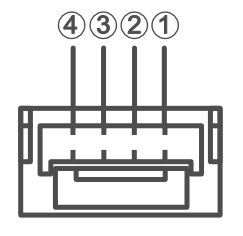

# Pixhawk 6C 飞控说明文档
---
## 一、基本信息
- **品牌**：Holybro
- **型号**：Pixhawk 6C
- **定位**：高性能多旋翼无人机飞控
- **本项目用量**：1个

## 二、处理器与板载传感器
### 核心处理器
| 处理器 | 规格 |
|--------|------|
| FMU处理器 | STM32H743，32位Arm Cortex-M7，480MHz，2MB Flash，1MB SRAM |
| IO处理器 | STM32F103，32位Arm Cortex-M3，72MHz，64KB SRAM |

### 板载传感器
| 传感器类型 | 型号 | 说明 |
|-----------|------|------|
| 加速度计/陀螺仪 | ICM-42688-P | 主IMU |
| 加速度计/陀螺仪 | BMI088 | 备用IMU（BMI055已停产） |
| 磁力计 | IST8310 | 罗盘 |
| 气压计 | MS5611 | 高度测量 |

## 三、电气参数
| 参数项 | 规格值 |
|--------|--------|
| 最大输入电压 | 6V |
| USB电源输入范围 | 4.75~5.25V |
| 舵机轨输入电压范围 | 0~36V |
| Telem1最大输出电流限制 | 1.5A |
| 其他所有端口总输出电流限制 | 1.5A |

## 四、机械参数
| 参数项 | 规格值 |
|--------|--------|
| 尺寸 | 84.8 × 44 × 12.4 mm |
| 重量（铝合金外壳） | 59.3g |
| 重量（塑料外壳） | 34.6g |

## 五、接口规格（引脚定义）
Pixhawk 6C 端口：https://docs.holybro.com/autopilot/pixhawk-6c/pixhawk-6c-ports

> 引脚编号从飞控右侧开始为Pin 1。I/O PWM OUT = MAIN OUT，FMU PWM OUT = AUX OUT。

### 1. 电源输入端口（Power1 & Power2）

| Pin | 颜色 | 信号 | 电压 |
|-----|------|------|------|
| 1 | 红 | VDD5V_BRICK1 (in) | +5V |
| 2 | 黑 | VDD5V_BRICK1 (in) | +5V |
| 3 | 黑 | CURRENT1 | +3.3V |
| 4 | 黑 | VOLTAGE1 | +3.3V |
| 5 | 黑 | GND | GND |
| 6 | 黑 | GND | GND |

- 本项目使用 **Power1** 接 PM06 电源模块 6P JST-GH 线
- 支持双电源冗余，两路电源输入端口规格相同

### 2. 串行端口

#### Telem1 端口（UART7，全流控）

| Pin | 颜色 | 信号 | 电压 |
|-----|------|------|------|
| 1 | 红 | VCC | +5V |
| 2 | 黑 | UART7_TX (out) | +3.3V |
| 3 | 黑 | UART7_RX (in) | +3.3V |
| 4 | 黑 | UART7_CTS (in) | +3.3V |
| 5 | 黑 | UART7_RTS (out) | +3.3V |
| 6 | 黑 | GND | GND |

- **本项目用途**：接 LQ 2.4G 数传模块天空端
- 波特率设置：115200

#### Telem2 端口（UART5，全流控）

| Pin | 颜色 | 信号 | 电压 |
|-----|------|------|------|
| 1 | 红 | VCC | +5V |
| 2 | 黑 | UART5_TX (out) | +3.3V |
| 3 | 黑 | UART5_RX (in) | +3.3V |
| 4 | 黑 | UART5_CTS (in) | +3.3V |
| 5 | 黑 | UART5_RTS (out) | +3.3V |
| 6 | 黑 | GND | GND |

- **本项目用途**：接 MTF-02 光流传感器
- 波特率设置：115200

#### Telem3 端口（USART2）

| Pin | 颜色 | 信号 | 电压 |
|-----|------|------|------|
| 1 | 红 | VCC | +5V |
| 2 | 黑 | USART2_TX (out) | +3.3V |
| 3 | 黑 | USART2_RX (in) | +3.3V |
| 4 | 黑 | NC / I2C4_SCL* | - / +3.3V |
| 5 | 黑 | NC / I2C4_SDA* | - / +3.3V |
| 6 | 黑 | GND | GND |

> *部分批次（SN: XXXX 001 XXXXXX）Telem3 的 Pin4/5 为 I2C4，非串口流控。该版本请勿将非I2C设备（如数传）接至Pin4/5。

### 3. GPS 端口

#### GPS1 端口（全功能）

| Pin | 颜色 | 信号 | 电压 |
|-----|------|------|------|
| 1 | 红 | VCC | +5V |
| 2 | 黑 | TX1 (out) | +3.3V |
| 3 | 黑 | RX1 (in) | +3.3V |
| 4 | 黑 | SCL1 | +3.3V |
| 5 | 黑 | SDA1 | +3.3V |
| 6 | 黑 | SAFETY_SWITCH | +3.3V |
| 7 | 黑 | SAFETY_SWITCH_LED | +3.3V |
| 8 | 黑 | IO_VDD_3V3 | +3.3V |
| 9 | 黑 | BUZZER- | 0~5V |
| 10 | 黑 | GND | GND |

- 集成安全开关、蜂鸣器、LED 驱动
- **本项目**：室内飞行，GPS1 不接 GPS 模块

#### GPS2 端口

| Pin | 颜色 | 信号 | 电压 |
|-----|------|------|------|
| 1 | 红 | VCC | +5V |
| 2 | 黑 | UART8_TX (out) | +3.3V |
| 3 | 黑 | UART8_RX (in) | +3.3V |
| 4 | 黑 | I2C2_SCL | +3.3V |
| 5 | 黑 | I2C2_SDA | +3.3V |
| 6 | 黑 | GND | GND |

### 4. I2C 端口

| Pin | 颜色 | 信号 | 电压 |
|-----|------|------|------|
| 1 | 红 | VCC | +5V |
| 2 | 黑 | I2C2_SCL* | +3.3V |
| 3 | 黑 | I2C2_SDA* | +3.3V |
| 4 | 黑 | GND | GND |

> *部分批次（SN: XXXX XXX 20221100 及更早）I2C 端口为 I2C4。

### 5. CAN 端口（CAN1 & CAN2）

| Pin | 颜色 | 信号 | 电压 |
|-----|------|------|------|
| 1 | 红 | VCC | +5V |
| 2 | 黑 | CAN1_H | +3.3V |
| 3 | 黑 | CAN1_L | +3.3V |
| 4 | 黑 | GND | GND |

### 6. 遥控输入端口

#### DSM RC 端口（JST-ZH 1.5mm）

| Pin | 颜色 | 信号 | 电压 |
|-----|------|------|------|
| 1 | 黄 | VDD_3V3_SPEKTRUM | +3.3V |
| 2 | 黑 | GND | GND |
| 3 | 灰 | DSM/SPEKTRUM IN | +3.3V |

#### PPM/SBUS RC 端口

| Pin | 颜色 | 信号 | 电压 |
|-----|------|------|------|
| 1 | - | VDD_5V_PPM_SBUS | +5V |
| 2 | 黄 | PPM&SBUS_IN | +3.3V |
| 3 | - | RSSI_IN | +3.3V |
| 4 | 红 | NC | - |
| 5 | 黑 | GND | GND |

- **本项目用途**：接接收机 SBUS/PPM 信号线

#### SBUS Out 端口

| Pin | 颜色 | 信号 | 电压 |
|-----|------|------|------|
| 1 | 红 | NC | - |
| 2 | 黄 | SBUS_OUT | +3.3V |
| 3 | 黑 | GND | GND |

### 7. PWM 输出端口

#### I/O PWM OUT（MAIN OUT）— 8路

| Pin | 颜色 | 信号 | 电压 |
|-----|------|------|------|
| 1 | 红 | VDD_Servo | - |
| 2 | 黑 | IO_CH1 | +3.3V |
| 3 | 黑 | IO_CH2 | +3.3V |
| 4 | 黑 | IO_CH3 | +3.3V |
| 5 | 黑 | IO_CH4 | +3.3V |
| 6 | 黑 | IO_CH5 | +3.3V |
| 7 | 黑 | IO_CH6 | +3.3V |
| 8 | 黑 | IO_CH7 | +3.3V |
| 9 | 黑 | IO_CH8 | +3.3V |
| 10 | 黑 | GND | GND |

- **本项目用途**：MAIN OUT 1-4 接 4 台好盈 40A 电调信号线
- IO_CH1~4 对应飞控 MAIN OUT 1~4

#### FMU PWM OUT（AUX OUT）— 8路

| Pin | 颜色 | 信号 | 电压 |
|-----|------|------|------|
| 1 | 红 | VDD_Servo | - |
| 2 | 黑 | FMU_CH1 | +3.3V |
| 3 | 黑 | FMU_CH2 | +3.3V |
| 4 | 黑 | FMU_CH3 | +3.3V |
| 5 | 黑 | FMU_CH4 | +3.3V |
| 6 | 黑 | FMU_CH5 | +3.3V |
| 7 | 黑 | FMU_CH6 | +3.3V |
| 8 | 黑 | FMU_CH7 | +3.3V |
| 9 | 黑 | FMU_CH8 | +3.3V |
| 10 | 黑 | GND | GND |

- **本项目**：AUX OUT 不接设备

### 8. USB 端口（Type-C）

| Pin | 颜色 | 信号 | 电压 |
|-----|------|------|------|
| 1 | 红 | VBUS | +5V |
| 2 | 黑 | DM | +3.3V |
| 3 | 黑 | DP | +3.3V |
| 4 | 黑 | GND | GND |

- **本项目用途**：连接电脑 QGroundControl 调参

### 9. 调试端口

#### FMU Debug 端口（JST SH 1.0mm）

| Pin | 颜色 | 信号 | 电压 |
|-----|------|------|------|
| 1 | 红 | FMU_VDD_3V3 | +3.3V |
| 2 | 黑 | FMU_USART3_TX | +3.3V |
| 3 | 黑 | FMU_USART3_RX | +3.3V |
| 4 | 黑 | FMU_SWD_IO | +3.3V |
| 5 | 黑 | FMU_SWD_CK | +3.3V |
| 6 | 黑 | SPI6_SCK_EXTERNAL1 | +3.3V |
| 7 | 黑 | NFC_GPIO | +3.3V |
| 8 | 黑 | PH11 | +3.3V |
| 9 | 黑 | FMU_nRST | +3.3V |
| 10 | 黑 | GND | GND |

#### I/O Debug 端口（JST SH 1.0mm）

| Pin | 颜色 | 信号 | 电压 |
|-----|------|------|------|
| 1 | 红 | IO_VDD_3V3 | +3.3V |
| 2 | 黑 | IO_USART1_TX | +3.3V |
| 3 | 黑 | NC | - |
| 4 | 黑 | IO_SWD_IO | +3.3V |
| 5 | 黑 | IO_SWD_CK | +3.3V |
| 6 | 黑 | IO_SWO | +3.3V |
| 7 | 黑 | IO_SPARE_GPIO1 | +3.3V |
| 8 | 黑 | IO_SPARE_GPIO2 | +3.3V |
| 9 | 黑 | IO_nRST | +3.3V |
| 10 | 黑 | GND | GND |

## 六、其他特性
- 工作温度范围：-40 ~ 85°C
- 支持固件：PX4、Ardupilot
- 接口兼容性：兼容Pixhawk标准接口

## 七、与本项目硬件适配
- 飞控安装孔距：30.5×30.5mm，与X400机架完美匹配
- 电调连接：16路PWM输出，本项目使用MAIN OUT 1-4连接4台好盈40A电调
- 光流传感器连接：可通过Telem1/Telem2串口连接MTF-02，波特率115200
- GPS连接：支持双GPS冗余配置（GPS1+GPS2）
- 电源输入：支持双电源冗余，通过2路模拟电源输入端口