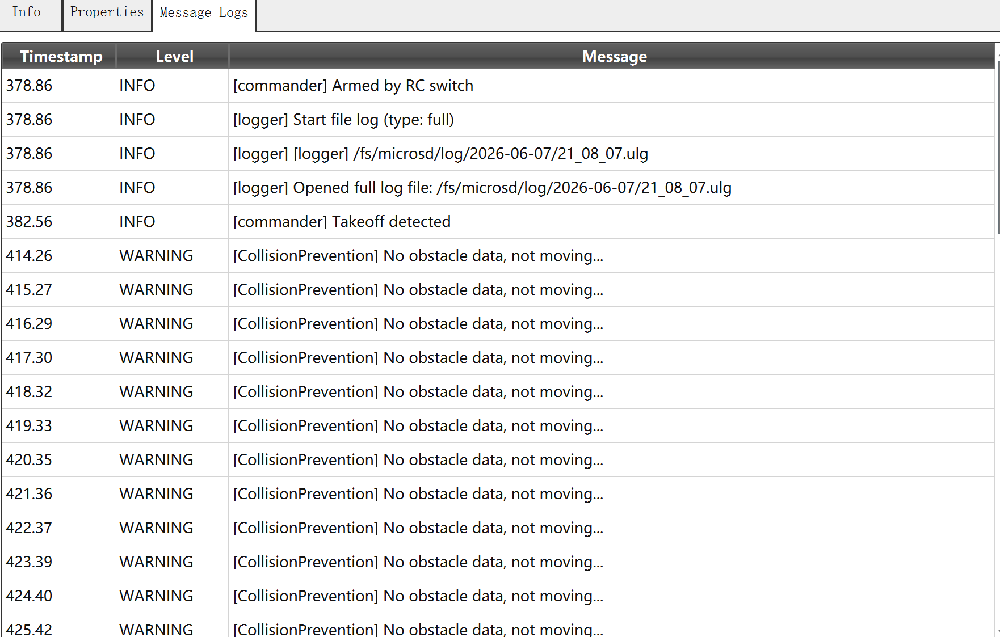

# 问题：Position 模式飞机不能移动

这次原因非常明确，就是 **避障 Collision Prevention 把水平移动锁死了**。



## 日志证据

```
[CollisionPrevention] No obstacle data, not moving...
```

## 根因

当前参数：
- `CP_DIST = 1.0` — 启用 Collision Prevention，安全距离 1 米
- `CP_GO_NO_DATA = 0` — 没有避障数据的方向，不允许移动

D435i / 机载电脑 / MAVROS 避障链路未运行时，PX4 收不到 `OBSTACLE_DISTANCE` 或 `DISTANCE_SENSOR` 数据，因此判定"没有障碍物数据，不许动"。

## 解决

**临时方案（当前无避障设备）：**
```
CP_DIST = -1    # 关闭 Collision Prevention
```

在 QGC 改：Parameters → `CP_DIST` → `-1` → Save → 重启飞控

或 MAVLink Console：
```
param set CP_DIST -1
param save
reboot
```

**装回避障设备并验证数据正常后：**
```
CP_DIST = 1.0
CP_GO_NO_DATA = 0
```

或仅放开无数据方向移动：
```
CP_GO_NO_DATA = 1
```

## 结论

不是遥控器问题，不是 Position 模式问题，是避障功能打开但没有避障数据。
